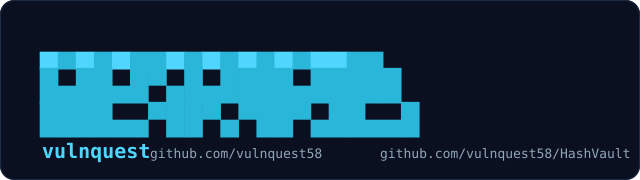

# HashVault

<p align="center">
  
</p>

<p align="center">
  <b>Evidence-driven password hash analysis, recovery, and audit reporting.</b><br>
  Built for authorized security testing, credential audits, CTFs, and research.
</p>

<p align="center">
  <a href="https://github.com/vulnquest58/HashVault/actions/workflows/ci.yml"></a>
  <a href="https://github.com/vulnquest58/HashVault"></a>
  <a href="LICENSE"></a>
  <a href="SECURITY.md"></a>
  <a href="CHANGELOG.md"></a>
</p>

HashVault is an offline-first password hash workbench. It identifies hashes,
unwraps encoded inputs, routes work to hashcat, John the Ripper, or a built-in
engine, and records auditable evidence of what happened. It is designed for
people who need repeatable results rather than a one-off command line.

> **Authorized use only.** Use HashVault only on systems and data you own or
> have explicit written permission to assess. You are responsible for complying
> with applicable law and engagement rules.

## Why HashVault

Most hash tools answer one question: "What is this hash?" HashVault answers the
questions that matter during an assessment:

- What is this input, including any encoding or wrapping layers?
- Which hash format and cracking route are most likely?
- What evidence supports that conclusion?
- What was attempted, what succeeded, and what remains uncertain?
- Can the result be reproduced and verified later?

The v2.0 **campaign** engine treats a credential corpus as evidence. Recovered
plaintexts are reused across the corpus, usernames and context drive bounded
mutations, every recovery is verified, and certificates commit to results
without exposing plaintext.

## Highlights

- **Deep input analysis** - bounded beam search across 54 reversible operations:
  encodings, compression, archives, classical ciphers, keyed transforms, and
  extractors.
- **Multi-layer identification** - 482 curated patterns, 473 generated hashcat
  modes, confidence scoring, and empirical ambiguity resolution.
- **File-to-hash conversions** - managed John helper store, auto-profile
  selection, bounded-memory file detection, and the official
  [auto2john](https://github.com/vulnquest58/auto2john) engine as a vendored
  component.
- **Campaign recovery** - corpus-wide inference with exact-reuse propagation,
  context mutations, wordlist passes, slow-KDF controls, and JSON reports.
- **Proof-carrying results** - plaintext-free Ed25519-signed certificates with
  SHA-256 plaintext commitments.
- **Multiple engines** - hashcat, John the Ripper, and a dependency-light
  built-in engine for dictionary, rule, mask, and hybrid attacks.
- **Audit operations** - `doctor`, `audit`, `insights`, `parameters`,
  `patterns-audit`, `calibrate`, `plan`, signed `evidence` reports, and
  `corpus validate`.
- **Offline by default** - no telemetry, no cloud calls, and optional local-only
  LLM assistance that is disabled unless explicitly configured.

## Quick Start

### Requirements

- Python 3.11 or newer
- [uv](https://docs.astral.sh/uv/) (recommended) or pip
- Optional: [hashcat](https://hashcat.net/hashcat/) and
  [John the Ripper](https://www.openwall.com/john/) for external engines

### Install from source

```bash
git clone https://github.com/vulnquest58/HashVault.git
cd HashVault

uv venv
uv pip install -e ".[dev,builtin]"
source .venv/bin/activate        # Windows: .venv\Scripts\activate

hashvault setup
hashvault doctor
```

With pip instead:

```bash
python -m venv .venv
source .venv/bin/activate        # Windows: .venv\Scripts\activate
pip install -e ".[dev,builtin]"
hashvault setup
hashvault doctor
```

`hashvault setup` initializes the local SQLite catalogue and resources.
`hashvault doctor` checks the database, patterns, corpora, wordlists, rules,
engines, optional verifiers, and configuration.

### Install a release wheel

Release wheels bundle the runtime `data/` and `config/` trees:

```bash
uv venv
uv pip install "https://github.com/vulnquest58/HashVault/releases/download/v2.3.0/hashvault-2.3.0-py3-none-any.whl"
source .venv/bin/activate        # Windows: .venv\Scripts\activate

hashvault setup
hashvault doctor
```

### First commands

```bash
# Identify a hash
hashvault identify 5f4dcc3b5aa765d61d8327deb882cf99

# Analyse an encoded or wrapped input
hashvault analyze 'JDJ5JDEwJHlNeXBJajFrZVVWQXFCSjY5MmYuLlhYbjB2ZnlCTDdDMUVoTzM1RzU5TnhtdEovdGl5'

# Crack with the built-in engine
hashvault crack 5f4dcc3b5aa765d61d8327deb882cf99 \
  --tool builtin --wordlist data/wordlists/quick_1000.txt

# Inspect the corpus recovery plan without touching a hash
hashvault campaign plan examples/0xdf-demo.txt

# Convert a protected file, then identify or crack the extracted material
hashvault convert --sync
hashvault convert protected.zip --save

# Inspect or run the official auto2john engine directly
hashvault auto2john protected.zip --detect-only
hashvault auto2john protected.zip --json

# Validate the shipped corpus before trusting its counts
hashvault corpus validate
```

## Campaign Recovery

Campaigns are the core of HashVault v2.0. They are designed for authorized
credential audits where a set of hashes and some contextual knowledge are
available.

```bash
# Reuse known plaintexts, propagate exact matches, and apply bounded mutations
hashvault campaign run examples/0xdf-demo.txt \
  --known-file examples/0xdf-known.json \
  --max-candidates 50000 \
  --json > campaign-report.json

# Add a wordlist pass
hashvault campaign run examples/0xdf-demo.txt \
  --known-file examples/0xdf-known.json \
  --wordlist data/wordlists/quick_1000.txt

# Resume a long campaign from a checkpoint
hashvault campaign run examples/0xdf-demo.txt \
  --checkpoint checkpoints/demo.json --progress
hashvault campaign run examples/0xdf-demo.txt \
  --resume checkpoints/demo.json --progress

# Import already-recovered values from hashcat/John
hashvault campaign run examples/0xdf-demo.txt \
  --potfile hashcat.potfile

# Create a plaintext-free, signed recovery certificate
hashvault campaign keygen campaign.key campaign.pub
hashvault campaign run examples/0xdf-demo.txt \
  --known-file examples/0xdf-known.json \
  --certificate campaign.json --sign-key campaign.key
hashvault campaign verify campaign.json --public-key campaign.pub
```

Certificates contain target hashes, pattern decisions, methods, plaintext
SHA-256 commitments, and coverage/uncertainty notes. They never contain
recovered plaintext. Use `--redact` to hide plaintext in terminal and JSON
output. Slow KDFs are skipped in mutation and wordlist stages unless
`--include-slow` is explicit.

The bundled `examples/0xdf-demo.txt` is derived from the 0xdf corpus described
in [docs/CORPUS.md](docs/CORPUS.md). It is intended for testing and
documentation only.

## Supported Workflows

| Workflow | Command |
| --- | --- |
| Identify a hash or wrapped input | `hashvault identify` |
| Deep analysis and live beam search | `hashvault analyze` |
| Crack with hashcat, John, or built-in | `hashvault crack` |
| Corpus recovery campaign | `hashvault campaign run` |
| Batch process a file | `hashvault batch` |
| Context-aware mutation | `hashvault mutate` |
| Hash parameter and work-factor analysis | `hashvault parameters` |
| File-to-hash conversion gallery | `hashvault convert` |
| Official auto2john engine | `hashvault auto2john` |
| Environment readiness checks | `hashvault doctor` |
| Re-verify stored plaintexts | `hashvault audit` |
| Aggregate audit insights | `hashvault insights` |
| Pattern quality audit | `hashvault patterns-audit` |
| Confidence calibration | `hashvault calibrate` |
| Cracking budget planning | `hashvault plan` |
| Signed audit evidence | `hashvault evidence` |
| Interactive shell | `hashvault interactive` |

See [docs/CLI.md](docs/CLI.md) for the full command reference and examples.

## Architecture

```text
input
  |
  v
[0] convert (optional)  file -> hash material (convert / auto2john)
  |
  v
[1] analyzer            bounded beam search across reversible operations
  |
  v
[2] identifier          catalogue + curated patterns + confidence
  |
  v
[3] canonicalizer       split username, normalize payload
  |
  v
[4] router              hashcat / John / built-in, adaptive ordering
  |
  v
[5] executor            session-isolated subprocesses, budgets, retries
  |
  v
[6] reporter            Rich / JSON / CSV, attempts, ambiguity, recipes
  |
  v
[7] operations          doctor / audit / insights / stats / evidence
```

The campaign engine runs beside this pipeline and adds corpus-level planning,
exact-reuse propagation, mutation stages, verification, and certificate
generation. See [docs/ARCHITECTURE.md](docs/ARCHITECTURE.md) for details.

## Documentation

- [CLI reference](docs/CLI.md)
- [Architecture](docs/ARCHITECTURE.md)
- [Corpus provenance and 0xdf cases](docs/CORPUS.md)
- [File-to-hash conversions](docs/CONVERSIONS.md)
- [Evidence reports and trust](docs/EVIDENCE.md)
- [Release process](docs/RELEASE.md)
- [Roadmap](docs/ROADMAP.md)
- [Launch and promotion kit](docs/PROMOTION.md)
- [FAQ](docs/FAQ.md)
- [Contributing](CONTRIBUTING.md)
- [Security policy](SECURITY.md)
- [Code of conduct](CODE_OF_CONDUCT.md)
- [Changelog](CHANGELOG.md)

## Development

```bash
uv venv
uv pip install -e ".[dev,builtin]"
python -m pytest -q --cov=hashvault --cov-fail-under=70
python -m ruff check hashvault/campaign hashvault/core/evidence.py \
  hashvault/core/evidence_schema.py hashvault/core/corpus_validator.py \
  tests/test_campaign.py tests/test_evidence_schema.py \
  tests/test_corpus_validator.py
python -m compileall -q hashvault tests
```

The current suite contains 473 tests. The campaign, evidence, and corpus
validation packages are lint-clean; the legacy codebase has a larger lint/type
backlog tracked in the roadmap.

## Security and Legal

HashVault is a dual-use security tool. It must only be used for authorized
security testing, credential audits, CTF environments, and research. Read
[SECURITY.md](SECURITY.md) for the vulnerability disclosure process and
[the legal notice](docs/CLI.md#legal-and-ethical-use) before use.

Do not use HashVault to access systems or data without permission.

## Contributing

Contributions are welcome. Good entry points include new corpus cases,
additional verifier tests, documentation improvements, bug reports, and
well-scoped feature proposals. Read [CONTRIBUTING.md](CONTRIBUTING.md) and the
[roadmap](docs/ROADMAP.md) before starting.

## License

MIT. See [LICENSE](LICENSE).

## Acknowledgments

- [0xdf](https://0xdf.gitlab.io/) for detailed Hack The Box writeups and
  published password/hash examples used in the test corpus.
- [hashcat](https://hashcat.net/hashcat/) and
  [John the Ripper](https://www.openwall.com/john/) for the underlying cracking
  engines and format documentation.
- The open-source security community for corpus data, format references, and
  reproducible testing practices.
